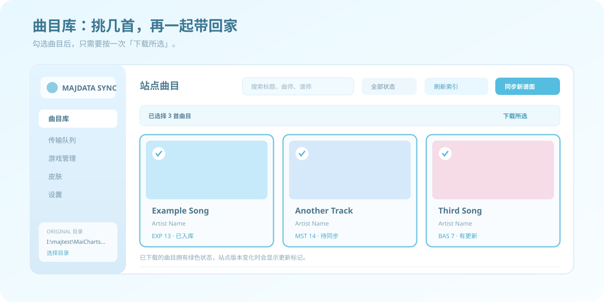
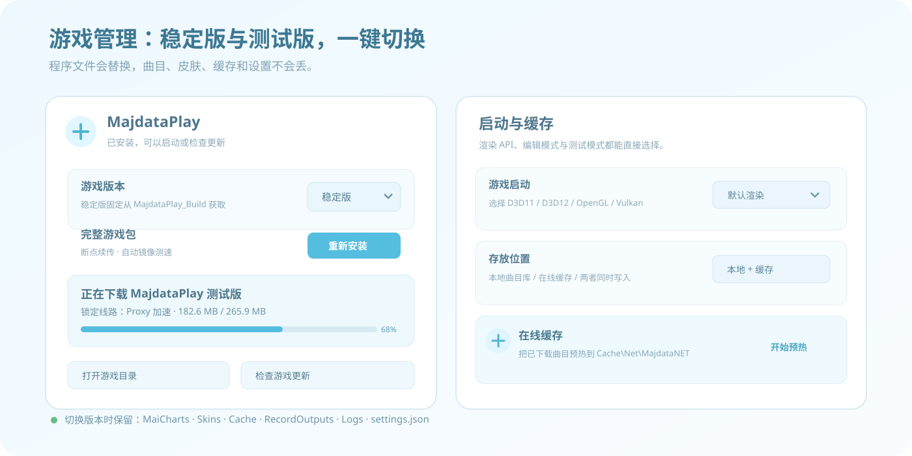
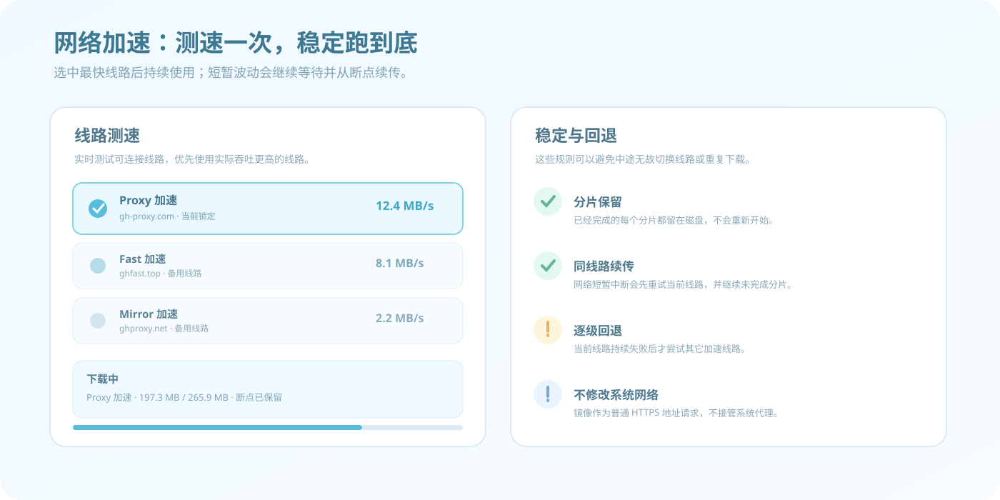
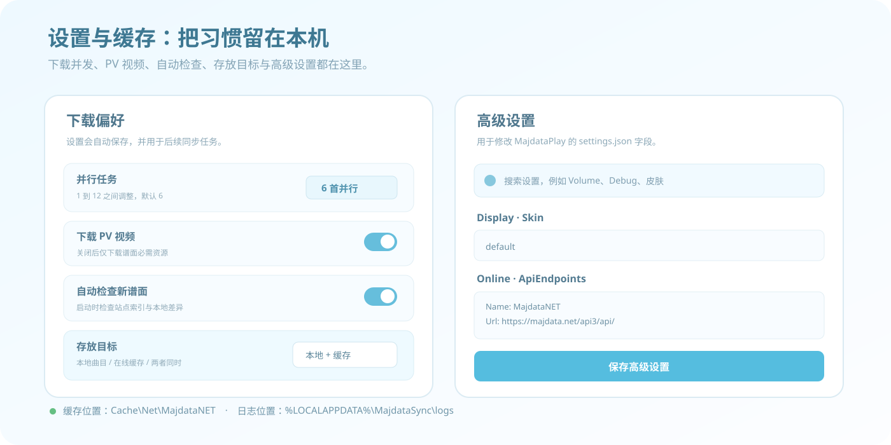

# Majdata Sync

[](https://github.com/Zppppp124/MajdataSync/actions/workflows/build.yml)
[](https://github.com/Zppppp124/MajdataSync/releases/latest)
[](https://github.com/Zppppp124/MajdataSync/releases/latest)


**Majdata Sync** 是一个给 MajdataPlay 玩家使用的 Windows 曲库工具：从 [majdata.net](https://majdata.net) 找谱面，勾选后批量下载，自动整理成游戏可以直接读取的文件夹；同时还能管理游戏版本、在线缓存、皮肤和内置设置。

它会自动识别游戏目录，不绑定盘符；每首曲目下载完成就立即入库，意外中断也不会把已经完成的曲目重下一遍。

> 给喜欢的谱面，点一个大大的赞吧。

## 亮点

| 曲目库 | 游戏管理 | 网络与缓存 |
| --- | --- | --- |
| 勾选曲目后批量下载 | 稳定版 / 测试版切换 | 谱面本站与镜像优选 |
| 每首完成立即入库 | 完整包断点续传 | 本地 / 在线缓存双写 |
| 日期筛选与增量更新 | 启动、渲染 API、编辑模式 | 皮肤下载与直接应用 |

## 下载

当前版本：**v1.9.1**

[**下载 Windows x64 自包含版本**](https://github.com/Zppppp124/MajdataSync/releases/download/v1.9.1/MajdataSync-win-x64-v1.9.1.zip) · [离线 HTML 使用说明书](docs/MajdataSync-Manual.html) · [查看全部版本](https://github.com/Zppppp124/MajdataSync/releases)

Windows 10/11 可直接运行，无需单独安装 .NET。程序界面使用 WebView2，大多数 Windows 10/11 已预装该运行时。

## 快速开始

1. 下载 ZIP 后**完整解压**到一个普通文件夹，再双击 `MajdataSync.exe`。
2. 首次打开选择 MajdataPlay 游戏根目录，或直接选择 `MaiCharts\Original`。
3. 点击“刷新索引”，等待曲目列表出现。
4. 搜索或按日期筛选；打勾后点击“下载所选”，或使用“同步新谱面”“下载全部谱面”。

> [!TIP]
> 不要直接在 WinRAR 等压缩包临时目录里运行。临时目录可能被清理，可能让下载中的窗口突然消失。建议先解压，并关闭正在运行的 MajdataPlay 再批量下载或切换版本。

## 曲目库



### 选择与批量下载

- 曲目卡左上角有可勾选圆点，选择后“下载所选”按钮启用，只处理打勾曲目。
- “同步新谱面”只同步未下载或站点哈希已变化的版本。
- “下载全部谱面”与筛选结果适合补抓整个时间段或完整曲库。
- 卡片右上角状态区分：已入库、未下载、有更新。

### 每首完成立即入库

每首曲目在下载并校验成功后立即保存到同步索引。即使后续曲目下载失败或程序停止，已完成的部分仍然保留；重新同步只会继续缺少的曲目。

### 日期更新

“按日期更新”可选择上传日期区间，适合补抓某次活动或某个发布时间段的谱面。

## 游戏管理



在“游戏管理”页可以选择版本通道、下载/重装游戏、检查更新、打开目录、启动游戏。

| 通道 | 下载来源 | 更新方式 |
| --- | --- | --- |
| **稳定版** | `TeamMajdata/MajdataPlay_Build` | 逐文件校验、下载和断点续传 |
| **测试版 nightly** | `TeamMajdata/MajdataPlay` | 下载完整 nightly 包后安全替换程序文件 |

切换版本时会保留 `MaiCharts`、`Skins`、`Cache`、`RecordOutputs`、`Logs` 和 `settings.json`。程序文件会替换，但曲目、皮肤、缓存、成绩输出、日志和设置不会丢失。切换前仍建议关闭游戏。

## 网络加速与续传



- 大型游戏包会测试 `ghfast.top`、`gh-proxy.com`、`ghproxy.net` 与 GitHub 直连。
- 测速后锁定一个能稳定传输的线路，所有分片都走该线路，不再每个分片轮换镜像。
- 当前线路短暂中断时，会等待并利用已有分片继续下载；下载任务没有总重试轮数上限。
- 只有当前线路持续无进度，才切换到其它线路；切换时保留已完成分片并继续续传。
- 游戏包下载或应用更新会一直运行，直到包完整、长度校验成功并安全替换为止。只有你主动停止、关闭程序，或遇到磁盘空间/文件权限等无法恢复的错误才会结束。
- 谱面索引与资源下载会优先测试 Majdata 本站和同源镜像，自动回退主站。

镜像只是在程序中替换 GitHub 下载地址，不会安装、启动或接管系统代理。能否连接仍取决于本机网络、DNS、防火墙和镜像站状态。

## 在线缓存

顶部“存放位置”支持三种模式：

- **本地 + 在线缓存**：同时写入 `Original` 与游戏在线缓存。
- **仅本地曲目库**：只保留可直接游玩的本地谱面目录。
- **仅在线缓存**：只写入 `Cache\Net\MajdataNET`。

“预热在线缓存”会把已有本地曲目写入在线缓存目录，并按游戏规则生成 `.sha256` 文件。

## 皮肤与设置



- 皮肤页可读取社区皮肤列表，下载、重装并直接应用 `Display.Skin`。
- 常用设置支持并行任务数、PV 视频、自动检查、谱面镜像和存放位置。
- 游戏管理页可读取 `settings.json`，高级设置会列出内置表单未显示的字段。
- 高级设置提供中文说明、默认值、有效值、分组与搜索。

## 曲目目录结构

下载曲目会直接生成 `Original\曲名\`，文件位于曲目目录根部，不保留 ZIP：

```text
Original
└─ 曲名
   ├─ maidata.txt
   ├─ track.mp3
   ├─ bg.jpg
   ├─ pv.mp4
   ├─ id
   └─ .majdata-sync.json
```

| 内容 | 位置 |
| --- | --- |
| 本地曲目 | `MaiCharts\Original\曲名\` |
| 同步索引 | `Original\.majdata-sync-index.json` |
| 在线缓存 | `Cache\Net\MajdataNET` |
| 曲库索引缓存 | `%LOCALAPPDATA%\MajdataSync\catalog.json` |
| 运行日志 | `%LOCALAPPDATA%\MajdataSync\logs` |

部分已有 MajdataPlay 谱面使用 `track.opus` 或 `bg.png`。程序不会修改无关的现有曲目，只写入自己下载或导入的曲目目录。

## 常见问题

<details>
<summary><strong>下载窗口突然消失，怎么办？</strong></summary>

先确认程序是从普通文件夹运行的，不是 WinRAR 临时目录。新版本会在启动日志里记录版本和运行路径。仍出现时，打开运行日志查看是否有 `Unhandled UI exception`。

</details>

<details>
<summary><strong>为什么下载速度会变慢？</strong></summary>

镜像、CDN、本机网络和防火墙都会影响速度。程序会为短暂波动保留断点并继续当前线路，只有持续失败才尝试其它线路。

</details>

<details>
<summary><strong>切换测试版会丢曲目吗？</strong></summary>

不会。切换版本只替换游戏程序文件，保留曲目、皮肤、缓存、成绩输出、日志和设置。

</details>

## 从源码构建

需要 .NET 8 SDK：

```powershell
dotnet build .\MajdataSync\MajdataSync.csproj -c Release
dotnet publish .\MajdataSync\MajdataSync.csproj -c Release -r win-x64 --self-contained true -p:PublishSingleFile=false -o .\MajdataSync\publish
```

在发布包根目录可以把使用说明一起打包：

```powershell
powershell -NoProfile -ExecutionPolicy Bypass -File .\build-release.ps1
```

## 说明

- 站点接口与页面资源来自 `https://majdata.net`。网络不可用、Cloudflare 限流或站点改版时，程序会显示具体错误，不会误删现有曲目。
- 谱面镜像通过相同曲目 ID 和 `/api3/api/maichart/...` 接口读取数据。
- 下载采用临时目录写入，只有必需文件齐全后才移动到 `Original`，避免产生半成品曲目。
- ZIP 导入要求包内包含 `maidata.txt`。
- 应用皮肤只会更新 `settings.json` 的 `Display.Skin`；高级设置只写入修改后的字段。
- 程序界面使用 WebView2；Windows 10/11 通常已预装 Microsoft Edge WebView2 Runtime。

## 致谢

- [majdata.net](https://majdata.net)：谱面索引与下载来源。
- [TeamMajdata](https://github.com/TeamMajdata)：MajdataPlay 游戏、构建包与皮肤。
- 所有为 MajdataPlay 制作谱面、皮肤与工具的朋友。
